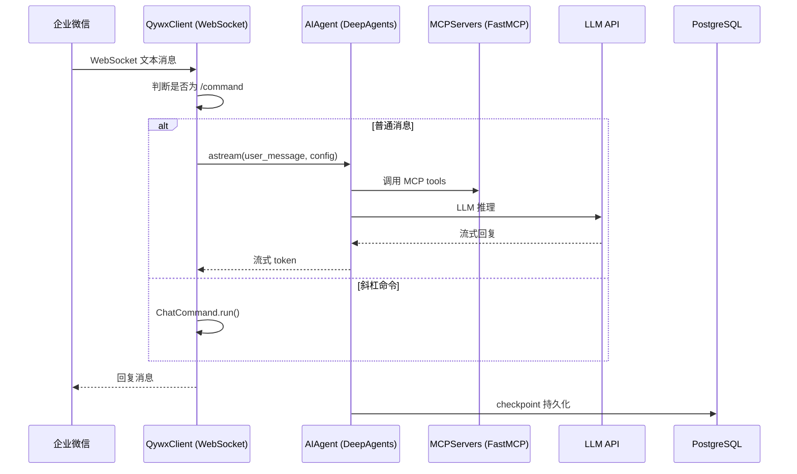

# AGENTS.md

## 1. 项目概述

- **项目类型**: 企业微信 AI 机器人服务
- **核心功能**: 通过企业微信 WebSocket 接收用户消息，经由 DeepAgents + Multi-MCP 工具链处理，非流式返回 AI 回复
- **技术栈**: Python 3.13+, FastAPI + Uvicorn, DeepAgents (LangGraph 之上), FastMCP, LangChain Anthropic, PostgreSQL
- **关键依赖**: `deepagents`, `fastmcp`, `langchain-anthropic`, `wecom-aibot-python-sdk`, `langgraph-checkpoint-postgres`, `loguru`
- **架构特点**: 异步优先、单例模式组件管理、FastAPI Lifespan 生命周期控制、组合式 MCP Server 挂载

## 2. 环境搭建

### 2.1 前置条件

- Python >= 3.13
- [uv](https://docs.astral.sh/uv/) 包管理器
- 远端 PostgreSQL（用于 LangGraph Checkpointer 持久化会话状态）
- ⚠️ 服务启动前 PostgreSQL **必须**已正常运行，否则启动失败

### 2.2 安装依赖

```bash
uv sync
```

### 2.3 配置文件

```bash
cp conf/config.toml.example conf/config.toml
```

编辑 `conf/config.toml`，至少填写：

```
[agent]
base_url = "your-llm-api-base-url"
api_key = "your-api-key"
model = "your-model-name"

[qywx]
bot_id = "your-bot-id"
secret = "your-secret"

[database.postgres]
host = "127.0.0.1"
user = "your-user"
password = "your-password"
dbname = "your-database"
```

### 2.4 启动开发服务

```bash
uv run qywx_bot.py
```

## 3. 开发命令

| 用途 | 命令 |
|------|------|
| 启动服务 | `uv run qywx_bot.py` |
| Ruff 检查 | `uv run ruff check .` |
| Ruff 格式化 | `uv run ruff format .` |
| isort 排序导入 | `uv run isort .` |
| 一键格式化 | `uv run ruff format . && uv run isort .` |
| 添加依赖 | `uv add <package-name>` |
| 添加开发依赖 | `uv add --dev <package-name>` |

## 4. 项目结构

```
qywx-bot/
├── qywx_bot.py                 # 应用入口：FastAPI 创建、lifespan、MCP 挂载
├── pyproject.toml              # 项目元数据、依赖、ruff/isort 配置
├── conf/
│   ├── config.toml.example     # 配置文件模板
│   └── config.toml             # 实际配置（不纳入版本控制）
├── pkg/                        # 基础设施层（无业务逻辑）
│   ├── config/                 # TOML → Pydantic 配置加载（单例 cfg）
│   ├── database/               # PostgreSQL AsyncConnectionPool 管理
│   ├── log/                    # Loguru 日志封装（AppLogger 单例）
│   ├── exceptions/             # 业务异常定义（如 TimeoutException）
│   └── utils/                  # 共享工具（httpx 客户端等）
├── internal/                   # 业务逻辑层
│   ├── ai_agent/               # DeepAgents agent 管理
│   │   ├── common.py           # LLM 工厂、MCPServers 组合、checkpointer 初始化
│   │   ├── agent.py            # AIAgent 单例：deep agent 创建与生命周期
│   │   └── middlewares/        # AgentMiddleware 扩展（如 ToolCallMiddleware）
│   ├── mcp_servers/            # FastMCP Server 实现
│   │   ├── datatime_server.py  # 日期时间工具集
│   │   ├── composition_server.py # 组合多个 MCP Server 为单一入口
│   │   └── proxy_server.py     # 代理外部 MCP Server（如 dida365）
│   ├── qywx/                   # 企业微信 WebSocket 客户端与消息路由
│   └── commands/               # 聊天命令系统（/help, /demo 等）
└── temp/                       # Agent 运行时临时目录
```

**核心分层原则**:
- `pkg/` = 基础设施层，**禁止**包含业务逻辑
- `internal/` = 业务逻辑层，依赖 `pkg/`
- 入口文件 `qywx_bot.py` 只做组装，不做具体实现

## 5. 架构与数据流



**三个单例**:
- `pkg.config.cfg` — 全局配置
- `internal.qywx.qywx_client` — 企业微信客户端
- `internal.ai_agent.AIAgent` — DeepAgents 实例

## 6. 代码规范

### 6.1 格式化

- **行宽**: 120 字符
- **引号**: 双引号
- **缩进**: 空格（4 空格）
- **换行符**: LF
- **导入排序**: isort（black profile），分区顺序：FUTURE → STDLIB → THIRDPARTY → FIRSTPARTY → LOCALFOLDER

### 6.2 Lint 规则

Ruff 启用的规则集: `E`（pycodestyle）, `F`（Pyflakes）, `B`（flake8-bugbear）, `Q`（flake8-quotes）, `D101/D102/D103`（pydocstyle 公开接口 docstring）, `N`（pep8-naming）, `ANN`（flake8-annotations）

### 6.3 命名约定

| 类型 | 约定 | 示例 |
|------|------|------|
| 模块/文件 | `snake_case` | `ai_agent.py`, `qywx_client.py` |
| 类 | `PascalCase` | `AIAgent`, `ToolCallMiddleware` |
| 函数/方法 | `snake_case` | `get_llm()`, `init_checkpointer()` |
| 私有模块级变量 | `_UPPER_SNAKE` | `_PG_POOL`, `_PG_CHECKPOINTER` |
| 常量 | `UPPER_SNAKE` | 暂无公开常量 |
| 类型注解 | **必须**用 `Annotated` + `Field` 描述 Pydantic 字段 | `Annotated[str, Field(description="...")]` |

### 6.4 编码约定

- **异步优先**: 所有 I/O 操作必须 `async/await`
- **类型注解**: 所有 public 函数、方法、类属性必须有类型注解
- **单例模式**: 核心组件（Config, QywxClient, AIAgent）使用 `__new__` + `_initialized` 实现单例
- **Pydantic 配置校验**: 配置加载必须经过 `Config.model_validate()` 校验后再使用
- **日志初始化**: 导入 `pkg.log.logger` 即可使用，基于 Loguru 自动初始化
- **错误处理**: 工具调用使用 `ToolRetryMiddleware`（最多重试 2 次，`TimeoutException` 会触发重试）

### 6.5 ⚠️ Python 之禅约束

项目核心约束（来自 `AGENTS.md` 头注释）:
- 简单胜于复杂 — 能用内置实现不用第三方
- 扁平胜于嵌套 — 最多 3 层嵌套
- 可读性很重要 — 注释和文档字符串保持清晰

## 7. 扩展指南

### 7.1 添加新的聊天命令

1. 在 `internal/commands/` 下创建 `your_command.py`
2. 继承 `ChatCommand`，实现 `create_parser()` 和 `run()` 方法
3. 设置 `main_name`（命令前缀 `/`）、`description`、`is_visible`
4. 命令会被 `internal/commands/__init__.py` 中的 `load_chat_commands()` 自动发现

示例见 `internal/commands/demo.py`。

### 7.2 添加新的 MCP Server

1. 在 `internal/mcp_servers/` 下创建 `your_server.py`
2. 使用 `FastMCP(name="...")` 创建 server 实例
3. 用 `@mcp.tool()` 装饰器注册工具
4. 在 `internal/mcp_servers/composition_server.py` 中 `mount()` 你的 server
5. 在 `qywx_bot.py` 的 `create_app()` 中 `mount()` 你的 HTTP app

### 7.3 添加新的 Middleware

1. 在 `internal/ai_agent/middlewares/` 下创建
2. 继承 `AgentMiddleware`，重写 `wrap_tool_call()` / `awrap_tool_call()`
3. 在 `AIAgent._init_deep_agent()` 的 `middleware=[]` 列表中添加

## 8. 配置系统

配置文件: `conf/config.toml`（从 `conf/config.toml.example` 复制）。

**工作原理**:
- TOML → `Config.model_validate()` → Pydantic 模型校验
- 全局单例: `from pkg.config import cfg`
- 各子配置模型: `pkg/config/service.py`, `agent.py`, `qywx.py`, `postgres.py`, `thirdparties.py`

**配置结构以 `conf/config.toml` 为准**——它始终是权威来源。当你需要了解当前有哪些配置项时，直接读取该文件。

## 9. 注意事项

- ⚠️ **永远不要**在 `conf/config.toml` 中提交真实的 API key
- ⚠️ 格式化提交前先运行 `uv run ruff check .` 确保无 lint 错误
- ⚠️ `pkg/` 目录下的模块**禁止**引用 `internal/` 目录，违反分层架构会导致循环依赖
- ⚠️ PostgreSQL Checkpointer 需要 `langgraph` 的标准表结构，首次启动时 `init_checkpointer(pg_pool, is_setup=True)` 会自动建表
- 企业微信 WebSocket 连接地址使用 `wss://openws.work.weixin.qq.com`（非公网 `wss://qywx.weixin.qq.com`）
